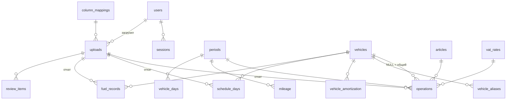

# FiberTrack — схема базы данных (этап 2, на согласование)

PostgreSQL 16, SQLAlchemy 2 + Alembic. Все деньги — `BIGINT` в копейках. Литры — `NUMERIC(12,3)`, километры — `INTEGER`.
Время — `TIMESTAMPTZ` (UTC в БД, Europe/Samara на экране — уточнить часовой пояс). У каждой таблицы `id BIGSERIAL`,
`created_at`, у изменяемых — `updated_at`.

## Принципы

1. **Источник правды — операции.** Прибыль, маржа, руб/км не хранятся, а считаются из операций, пробега и дней.
   Исключение: «итоговая прибыль» из исторической таблицы (статья `result_profit`, см. ниже) и снимок закрытого месяца.
2. **Каждая строка знает, откуда пришла:** `source` + `upload_id`. Откат загрузки = удаление всех строк с её `upload_id`
   в одной транзакции + запись в журнал.
3. **НДС хранится явно:** брутто, нетто, сумма НДС, ставка, режим ввода (`gross` / `net` / `unknown`).
   Для истории, где НДС не выделен, режим `unknown`: брутто = нетто, в отчётах «Без НДС» такие суммы помечаются.
4. **Ничего не угадываем:** всё, что не сопоставилось, попадает в `review_items` и не применяется,
   пока владелец не разберёт.
5. **Закрытый месяц неизменен:** триггер/проверка в сервисном слое запрещает INSERT/UPDATE/DELETE по `period_id`
   закрытого периода; при закрытии сохраняется снимок расчёта в `period_snapshots`.

## Таблицы

### Пользователи и безопасность
| Таблица | Поля | Комментарий |
|---|---|---|
| `users` | login UNIQUE, full_name, password_hash (bcrypt), role ENUM(`admin`,`viewer`,`input`), is_active, last_login_at | роль проверяется только на сервере |
| `sessions` | token_hash UNIQUE, user_id, csrf_token, expires_at, ip, user_agent, revoked_at | httpOnly cookie, хранится только хэш токена |
| `login_attempts` | login, ip, success, at | ограничение: 5 неудачных за 15 мин → блок на 15 мин |

### Справочники
| Таблица | Поля | Комментарий |
|---|---|---|
| `vehicles` | short_no UNIQUE (`308М`, `20М`, `885`), plate (`Т970ОН58`, нормализованный), plate_display, make ENUM(`MAN`,`DAF`,`FAW`,`SCANIA`,`MERCEDES`,`OTHER`), model, manufacture_year, tachograph, trailer_plate, trailer_model, trailer_year, fuel_card, driver_name, in_service_from, in_service_to, is_active, notes | суффикс М/Д/Ф = MAN/DAF/FAW |
| `vehicle_aliases` | vehicle_id, alias_norm, alias_raw, valid_from, valid_to, source | `020` → `20М` до 05.2026; `308 (М)`, `308м`, `308 М (0806)` → `308М` |
| `vehicle_amortization` | vehicle_id, valid_from, amount_kop | история амортизации, а не одно число |
| `vat_rates` | code, name, rate_bp (2200 = 22 %; NULL = «без НДС»), is_active, sort | 22 / 10 / 7 / 5 / 0 / без НДС, настраивается |
| `articles` | code UNIQUE, name, kind ENUM(`income`,`expense`,`shared`,`result`), sort, is_system | доходы, 12 расходных статей, общие (общехоз, сервис, трактор, амортизация), `result_profit` для истории |
| `status_dictionary` | pattern, match ENUM(`exact`,`prefix`,`contains`), status ENUM(…) , priority | «МОЙКА/ДЕФ 09:00» → `wash`; редактирует владелец |
| `settings` | key UNIQUE, value JSONB, updated_by | способ распределения (по умолчанию по рабочим дням), группы годов выпуска, пороги ГЛОНАСС, пределы пробега и л/100 км |

Статусы дня: `trip`, `trip_cont` (продолжение рейса — пустая ячейка после маршрута), `no_driver`, `idle_no_order`,
`repair_planned`, `repair_unplanned`, `wash`, `day_off`, `vacation`, `prep`, `sold`, `unknown`.

### Факты
| Таблица | Поля | Комментарий |
|---|---|---|
| `periods` | year, month, UNIQUE(year,month), status ENUM(`open`,`closed`), closed_at, closed_by | |
| `operations` | period_id, vehicle_id NULL (= общий), article_id, amount_gross_kop, amount_net_kop, vat_kop, vat_rate_id NULL, vat_mode ENUM(`gross`,`net`,`unknown`), source ENUM(`1c`,`template`,`manual`,`import`), upload_id NULL, document, comment, created_by, updated_by, deleted_at | CHECK: net + vat = gross; при «без НДС» vat = 0 |
| `mileage` | period_id, vehicle_id, km, source, upload_id, UNIQUE(period_id, vehicle_id) | вводит бухгалтер |
| `vehicle_days` | period_id, vehicle_id, worked, no_driver, loading, unloading, idle_no_order, repair_planned, repair_unplanned, other, basis ENUM(`manual_totals`,`computed`), computed JSONB, upload_id, UNIQUE(period_id, vehicle_id) | итог месяца; ручные итоги диспетчера главнее, пересчёт по ячейкам хранится рядом для сверки |
| `schedule_days` | vehicle_id, date, raw_text, status, upload_id, UNIQUE(vehicle_id, date) | для тепловой карты и календаря машины |
| `fuel_records` | vehicle_id, date, period_id, kind ENUM(`card_rn`,`card_e100`,`card_other`,`glonass`), liters, amount_gross_kop NULL, amount_net_kop NULL, vat_rate_id NULL, card_no, upload_id | ГЛОНАСС отдельной строкой; 0 из ГЛОНАСС ≠ «нет данных» — хранится NULL |
| `fleet_days_history` | period_id, worked, no_driver, idle_no_order, repair_planned, repair_unplanned | только итоги по парку из «Анализа простоев» (2021–2023), где помашинных данных нет |
| `reference_values` | period_id, vehicle_id NULL, metric ENUM(`profit`,`cost_per_km`,`rate_per_km`,`fleet_total`), value, note, source, upload_id | ваши заметки руб/км и итоги таблицы прибыли — эталон для «Сверки» |

### Загрузки и контроль
| Таблица | Поля | Комментарий |
|---|---|---|
| `uploads` | kind ENUM(`report_any`,`template`,`schedule`,`fuel`,`vehicles`,`history`), filename, storage_key, sha256, size, uploaded_by, status ENUM(`parsed`,`applied`,`rolled_back`,`failed`), preview JSONB, errors JSONB, mapping_id, applied_at/by, rolled_back_at/by | повторный файл с тем же sha256 → предупреждение о дубле |
| `column_mappings` | kind, name, header_signature (хэш заголовков), mapping JSONB, created_by | мастер колонок запоминает шаблон |
| `review_items` | upload_id, kind ENUM(`unmatched_vehicle`,`unknown_status`,`duplicate`,`validation`), raw_value, context JSONB, resolution JSONB, resolved_by, resolved_at | очередь «Проверить» |
| `audit_log` | at, user_id, action, entity, entity_id, before JSONB, after JSONB, upload_id, ip | только INSERT, без UPDATE/DELETE |
| `period_snapshots` | period_id, settings JSONB, payload JSONB, created_by | цифры закрытого месяца не «плывут» при смене настроек |

## Связи

## Как ложится история

| Источник | Куда | Период |
|---|---|---|
| прибыль_по_машинам.xlsx, строки машин | `operations` статья `result_profit`, vat_mode `unknown`, source `import` | 01–08.2026 |
| строки «общехоз», «сервис», «трактор», «амортизация» | `operations` с vehicle_id = NULL, статьи `shared_*` | 01–08.2026 |
| итог «Общий», заметки руб/км | `reference_values` | 01–08.2026 |
| график (листы 2023, 2024, 2025, 02.10.2026) | `schedule_days` + `vehicle_days` | 08.2023–10.2026 |
| «Анализ простоев» | `fleet_days_history` | 2021–07.2023 |
| «Анализ ЗАПРАВОК» | `fuel_records` (литры) | 26.05–30.09.2026 |
| «АВТО» | `vehicles`, `vehicle_aliases` | текущее состояние |

## Правила расчёта (кратко)

- **Прибыль машины** = доходы − расходы машины. Если за месяц есть только `result_profit`, берётся он.
  Если за тот же месяц есть и статьи, и `result_profit`, считаем по статьям, а `result_profit` показываем в «Сверке».
- **Распределение общих** (общехоз, сервис, трактор, амортизация без привязки к машине):
  поровну / по пробегу / по рабочим дням (по умолчанию). Амортизация конкретной машины всегда идёт на неё.
- **КИ** = рабочие дни / календарные дни в периоде владения (с учётом дат ввода и вывода).
- **Потери от простоя** = дни простоя × средний доход машины в рабочий день. Пока выручки нет — по прибыли,
  с явной подписью.

## Роль «Бухгалтер» на уровне API

Отдельный роутер `/api/input/*`, который отдаёт только: список открытых месяцев, справочник машин (чтение и правка,
с записью в `audit_log`), загрузки и операции за открытые месяцы, очередь `review_items`, прогресс «внесено N из M». Ни одна функция этого роутера не вызывает модуль расчётов.
Все прочие роутеры закрыты зависимостью `require_role(admin|viewer)`. Тесты проверяют каждый маршрут
приложения перебором на 403 для `input`.
